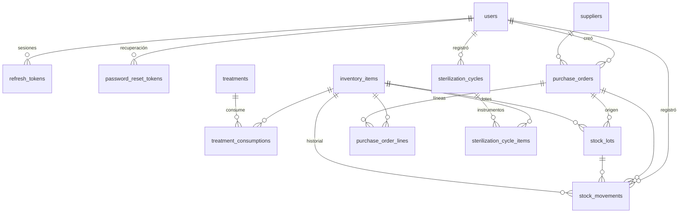

# Estructura base del backend — ClinicApp

Estado al **2026-11-15**: base del proyecto, `auth`, catálogo de `treatments` (con sus insumos) e `inventory`. Este documento describe **cómo está armada la API y qué guarda la base de datos**. Los endpoints están en [`endpoints-api.md`](./endpoints-api.md), y lo pendiente por módulo en [`../backlog.md`](../backlog.md).

## 1. Tecnología

| Pieza | Elección |
|---|---|
| API | .NET 10 (LTS), ASP.NET Core Web API con controladores |
| Acceso a datos | Entity Framework Core 10 + Npgsql. Migraciones en `Data/Migrations`; `dotnet-ef` 10.0.15 como herramienta local (`dotnet tool restore`). |
| Base de datos | PostgreSQL 17 en Docker (`docker-compose.yml`, contenedor `clinicapp-db`, puerto local 5433) |
| Autenticación | JWT (`Microsoft.AspNetCore.Authentication.JwtBearer` 10.0.15) y cookie de refresh `httpOnly` |
| Documentación interactiva | OpenAPI en `/openapi/v1.json` y Scalar en `/scalar` (solo en desarrollo) |

Los paquetes NuGet se fijan en la versión **10.0.15**: las versiones 11.x apuntan a .NET 11 y no compilan en este proyecto.

## 2. Organización del código

Un solo proyecto (`src/ClinicApp.Api`), con una carpeta por módulo. Los nombres de los módulos son los mismos de `front/src/modules/`.

```text
back/
├── ClinicApp.slnx, global.json, dotnet-tools.json
├── docker-compose.yml, .env.example        ← base de datos local
├── README.md, backlog.md, backlog-desgloce.md
├── docs/                                    ← este documento, endpoints-api.md y los planes en curso
├── tutorial/fase-0.md                       ← guía paso a paso de cómo se armó la base
└── src/ClinicApp.Api/
    ├── Program.cs                           ← servicios y pipeline (orden de los middlewares)
    ├── appsettings.json, appsettings.Development.json
    ├── ClinicApp.Api.http                   ← peticiones de prueba
    ├── Common/
    │   ├── Paging.cs                        ← PageQuery, PagedResult<T>, ToPagedResultAsync
    │   ├── ProblemDetailsSetup.cs           ← títulos de error en español; 500 sin detalle en producción
    │   ├── Validation.cs                    ← título de los 400, ValidationError(), [IsoDate]
    │   ├── RateLimits.cs                    ← límite de intentos de los endpoints públicos de auth
    │   ├── Email.cs                         ← IEmailSender (hoy solo escribe en el log)
    │   └── BearerSecuritySchemeTransformer.cs ← botón "Bearer" en Scalar
    ├── Data/
    │   ├── AppDbContext.cs                  ← un DbSet por tabla
    │   └── Migrations/
    └── Modules/
        ├── Auth/         ← usuarios, sesiones, recuperación de contraseña, solicitudes de acceso
        ├── Treatments/   ← catálogo de tratamientos y sus insumos
        └── Inventory/    ← insumos, lotes, movimientos, proveedores, órdenes, esterilización
```

**Patrón de cada módulo:**

| Archivo | Contenido |
|---|---|
| `*Entities.cs` o `<Entidad>.cs` | Clases que se convierten en tablas |
| `*Configuration.cs` | Detalles de cada tabla: largos, precisión, índices, `CHECK`, llaves foráneas. `AppDbContext` las aplica todas solo, con `ApplyConfigurationsFromAssembly`. |
| `*Dtos.cs` | Lo que entra y sale de la API. Son clases distintas de las entidades, para que la tabla pueda cambiar sin romper el contrato del frontend. Las reglas de validación replican los esquemas Zod del frontend. |
| `*Controller.cs` | Los endpoints |
| Servicios (`TokenService`, `StockService`) | Lógica compartida que no pertenece a un solo endpoint |

## 3. Convenciones de la base de datos

| Tema | Regla |
|---|---|
| Nombres | snake_case (`UseSnakeCaseNamingConvention`): `DurationMinutes` → `duration_minutes`, `pk_treatments`, `fk_stock_lots_inventory_items_item_id` |
| Identificadores | `uuid`. Los genera el servidor con `Guid.CreateVersion7()` (UUID v7: crecen con el tiempo, así que también sirven para ordenar). |
| Fechas con hora | `timestamptz`, siempre en UTC (`DateTime.UtcNow`) |
| Fechas sin hora | `date` (`DateOnly` en C#). En el JSON van como `"YYYY-MM-DD"`. |
| Dinero | `numeric(10,2)` (`decimal` en C#): hasta 99 999 999,99 sin errores de redondeo |
| Texto | `varchar(n)` con el largo máximo del formulario |
| Opciones fijas | Texto con restricción `CHECK` (por ejemplo `role IN ('admin', 'recepcion', 'medico')`). Los valores son los mismos del frontend. |
| Estructuras anidadas | `jsonb` (hoy solo `users.profile`; la historia clínica lo usará para sus secciones) |
| Borrados | Las tablas de historia (movimientos, lotes) usan **restrict**: no se puede borrar lo que tiene historial. Las partes de un todo (líneas de una orden, consumos de un tratamiento, tokens de un usuario) usan **cascade**. Las referencias de auditoría a `users` usan **set null**. |
| Auditoría | `created_by_user_id` en movimientos de stock, órdenes de compra y ciclos de esterilización (no se expone en la API) |
| Secretos | En la base nunca hay contraseñas ni tokens en claro: contraseñas con PBKDF2 (`PasswordHasher`), tokens de sesión y de recuperación como hash SHA-256 |

## 4. Diagrama de tablas



`access_requests` no tiene relaciones. `users.professional_id`, `sterilization_cycles.responsible_professional_id`, `stock_movements.patient_id` y `stock_movements.treatment_assignment_id` son UUID **sin llave foránea** todavía (ver § 8).

## 5. Módulo `auth`

### `users`

| Columna | Tipo | Nulo | Reglas |
|---|---|---|---|
| `id` | `uuid` PK | | |
| `email` | `varchar(254)` | | Único. Se guarda en minúsculas. |
| `name` | `varchar(120)` | | Nombre que se muestra |
| `password_hash` | `varchar(200)` | | PBKDF2. Se vuelve a calcular al iniciar sesión si el algoritmo se actualiza. |
| `role` | `varchar(20)` | | `admin`, `recepcion` o `medico` (`ck_users_role`) |
| `professional_id` | `uuid` | sí | Profesional vinculado. Sin FK hasta que exista `professionals`. |
| `active` | `boolean` | | Una cuenta desactivada no puede iniciar sesión (`403`) |
| `profile` | `jsonb` | sí | "Mi perfil": `{ fullName, title, specialty, bio, avatarColor, avatarImage }`. `avatarImage` es una data URL de hasta ~300 KB. |
| `created_at` | `timestamptz` | | |
| `last_login_at` | `timestamptz` | sí | |

### `refresh_tokens`

| Columna | Tipo | Nulo | Reglas |
|---|---|---|---|
| `id` | `uuid` PK | | |
| `user_id` | `uuid` FK → `users` (cascade) | | Índice |
| `token_hash` | `varchar(64)` | | SHA-256 en hexadecimal del token de la cookie. Único. |
| `created_at`, `expires_at` | `timestamptz` | | Vida: 7 días (`Auth:RefreshTokenDays`) |
| `revoked_at` | `timestamptz` | sí | Al cerrar sesión, al rotar o al detectar reuso |
| `replaced_by_token_id` | `uuid` | sí | Token que lo reemplazó al rotar. Sirve para detectar el reuso de un token robado. |

### `password_reset_tokens`

| Columna | Tipo | Nulo | Reglas |
|---|---|---|---|
| `id` | `uuid` PK | | |
| `user_id` | `uuid` FK → `users` (cascade) | | Índice |
| `token_hash` | `varchar(64)` | | SHA-256 del token del enlace. Único. |
| `created_at`, `expires_at` | `timestamptz` | | Vida: 60 minutos (`Auth:PasswordResetMinutes`) |
| `used_at` | `timestamptz` | sí | Un solo uso. Al pedir un enlace nuevo, los anteriores se invalidan. |

### `access_requests`

| Columna | Tipo | Nulo | Reglas |
|---|---|---|---|
| `id` | `uuid` PK | | |
| `email` | `varchar(254)` | | |
| `full_name` | `varchar(120)` | | |
| `institution` | `varchar(160)` | | Vacío si no se indicó |
| `message` | `varchar(1000)` | | Vacío si no se indicó |
| `status` | `varchar(20)` | | Siempre `pendiente` por ahora (no hay pantalla para revisarlas) |
| `created_at` | `timestamptz` | | Índice |

**Cuentas de desarrollo** (`UserSeeder`): con la tabla `users` vacía y en `Development`, se crean `admin@clinica.com` / `admin123`, `recepcion@clinica.com` / `recepcion123` y `medico@clinica.com` / `medico123`. En cualquier entorno se crea un administrador inicial si existen `Seed__AdminEmail` y `Seed__AdminPassword` (mínimo 12 caracteres).

## 6. Módulo `treatments`

### `treatments`

| Columna | Tipo | Nulo | Reglas |
|---|---|---|---|
| `id` | `uuid` PK | | |
| `name` | `varchar(120)` | | 2 a 120 caracteres |
| `category` | `varchar(80)` | | 2 a 80 caracteres |
| `description` | `varchar(1000)` | sí | |
| `duration_minutes` | `integer` | | 5 a 1440 |
| `price` | `numeric(10,2)` | | Precio de catálogo, 0 a 99 999 999,99 |
| `active` | `boolean` | | Los inactivos no se ofrecen en la historia clínica |
| `created_at` | `timestamptz` | | |

### `treatment_consumptions`

Insumos que consume un tratamiento cada vez que se realiza.

| Columna | Tipo | Nulo | Reglas |
|---|---|---|---|
| `treatment_id` | `uuid` FK → `treatments` (cascade) | | PK compuesta `(treatment_id, item_id)`: un insumo no se repite en el mismo tratamiento |
| `item_id` | `uuid` FK → `inventory_items` (restrict) | | Índice |
| `quantity` | `integer` | | ≥ 1 (`CHECK`) |

## 7. Módulo `inventory`

**Regla central:** `inventory_items.stock` es siempre igual a la suma de `stock_lots.quantity` del insumo.
- **Quién lo cambia:** solo `StockService`. Bloquea la fila del insumo (`SELECT … FOR UPDATE`) dentro de una transacción, así dos salidas simultáneas no pueden dejar el stock negativo.
- **Entradas:** cada entrada crea un lote.
- **Salidas:** descuentan por FEFO (primero en vencer, primero en salir). Los lotes sin vencimiento salen al final y, entre lotes iguales, sale primero el más antiguo. Se crea un movimiento por cada lote tocado.

### `inventory_items`

| Columna | Tipo | Nulo | Reglas |
|---|---|---|---|
| `id` | `uuid` PK | | |
| `name` | `varchar(120)` | | 2 a 120. Índice. |
| `category` | `varchar(80)` | | 2 a 80 |
| `unit` | `varchar(30)` | | "caja", "unidad", "ml"... |
| `kind` | `varchar(20)` | | `consumible` o `instrumental` (`CHECK`) |
| `min_stock` | `integer` | | ≥ 0. Si `stock <= min_stock`, el insumo está en stock crítico. |
| `unit_cost` | `numeric(10,2)` | | ≥ 0 |
| `supplier` | `varchar(120)` | sí | Texto libre (no enlaza con `suppliers`) |
| `stock` | `integer` | | ≥ 0 (`CHECK`). Solo lo cambia el servidor. |
| `created_at` | `timestamptz` | | |

### `stock_lots`

| Columna | Tipo | Nulo | Reglas |
|---|---|---|---|
| `id` | `uuid` PK | | |
| `item_id` | `uuid` FK → `inventory_items` (restrict) | | Índice `(item_id, expiration_date)` para el orden FEFO |
| `quantity` | `integer` | | Cantidad **restante**, ≥ 0 |
| `expiration_date` | `date` | sí | |
| `purchase_order_id` | `uuid` FK → `purchase_orders` (restrict) | sí | Orden de origen |
| `received_at` | `timestamptz` | | |

### `stock_movements` (inmutable)

| Columna | Tipo | Nulo | Reglas |
|---|---|---|---|
| `id` | `uuid` PK | | |
| `item_id` | `uuid` FK → `inventory_items` (restrict) | | Índice `(item_id, created_at)` |
| `type` | `varchar(10)` | | `entrada` o `salida` (`CHECK`) |
| `quantity` | `integer` | | > 0 |
| `reason` | `varchar(300)` | | |
| `lot_id` | `uuid` FK → `stock_lots` (restrict) | sí | Lote creado (entrada) o descontado (salida) |
| `purchase_order_id` | `uuid` FK → `purchase_orders` (restrict) | sí | |
| `treatment_assignment_id` | `uuid` | sí | Sin FK todavía. Lo llenará el consumo de un tratamiento realizado. |
| `patient_id` | `uuid` | sí | Sin FK todavía |
| `created_by_user_id` | `uuid` FK → `users` (set null) | sí | Auditoría |
| `created_at` | `timestamptz` | | |

### `suppliers`

| Columna | Tipo | Nulo | Reglas |
|---|---|---|---|
| `id` | `uuid` PK | | |
| `name` | `varchar(120)` | | 2 a 120 |
| `contact_name` | `varchar(120)` | sí | |
| `phone` | `varchar(30)` | sí | |
| `email` | `varchar(254)` | sí | Correo válido, en minúsculas |
| `address` | `varchar(250)` | sí | |
| `notes` | `varchar(1000)` | sí | |
| `created_at` | `timestamptz` | | |

### `purchase_orders`

| Columna | Tipo | Nulo | Reglas |
|---|---|---|---|
| `id` | `uuid` PK | | |
| `supplier_id` | `uuid` FK → `suppliers` (restrict) | | Índice |
| `status` | `varchar(20)` | | `pendiente`, `recibida` o `cancelada` (`CHECK`) |
| `notes` | `varchar(1000)` | sí | |
| `created_by_user_id` | `uuid` FK → `users` (set null) | sí | |
| `created_at` | `timestamptz` | | Índice |
| `received_at` | `timestamptz` | sí | Se fija al recibir |

### `purchase_order_lines`

| Columna | Tipo | Nulo | Reglas |
|---|---|---|---|
| `id` | `uuid` PK | | No se expone |
| `purchase_order_id` | `uuid` FK → `purchase_orders` (cascade) | | |
| `position` | `integer` | | Orden de la línea en la orden (0, 1, 2...) |
| `item_id` | `uuid` FK → `inventory_items` (restrict) | | |
| `quantity` | `integer` | | ≥ 1 |
| `unit_cost` | `numeric(10,2)` | | ≥ 0 |
| `expiration_date` | `date` | sí | Vencimiento del lote que se crea al recibir |

### `sterilization_cycles`

| Columna | Tipo | Nulo | Reglas |
|---|---|---|---|
| `id` | `uuid` PK | | |
| `performed_at` | `date` | | No futura. Índice. |
| `result` | `varchar(20)` | | `aprobado` o `fallido` (`CHECK`) |
| `responsible_professional_id` | `uuid` | | Sin FK hasta que exista `professionals` |
| `notes` | `varchar(1000)` | sí | |
| `created_by_user_id` | `uuid` FK → `users` (set null) | sí | |
| `created_at` | `timestamptz` | | |

### `sterilization_cycle_items`

| Columna | Tipo | Nulo | Reglas |
|---|---|---|---|
| `cycle_id` | `uuid` FK → `sterilization_cycles` (cascade) | | PK compuesta `(cycle_id, item_id)` |
| `item_id` | `uuid` FK → `inventory_items` (restrict) | | Solo insumos `instrumental` (lo valida la API) |

## 8. Migraciones aplicadas

| Migración | Crea |
|---|---|
| `20261114042117_CrearTratamientos` | `treatments` |
| `20261115051345_CrearUsuariosYSesiones` | `users`, `refresh_tokens`, `password_reset_tokens`, `access_requests` |
| `20261115180228_CrearInventario` | Las 8 tablas de inventario y `treatment_consumptions` |

Para crear o actualizar la base local: `dotnet ef database update --project src/ClinicApp.Api` (desde `back/`). Antes de aplicar una migración nueva, se revisa su SQL con `dotnet ef migrations script <anterior> <nueva> --project src/ClinicApp.Api`.

**Llaves foráneas pendientes:** se agregarán con una migración cuando existan las tablas destino.

| Columna | Tabla destino | Módulo |
|---|---|---|
| `users.professional_id` | `professionals` | `appointments` |
| `sterilization_cycles.responsible_professional_id` | `professionals` | `appointments` |
| `stock_movements.patient_id` | `patients` | `patients` |
| `stock_movements.treatment_assignment_id` | `treatment_assignments` | `treatments` (Jorge) |

**Módulos sin tablas todavía:**
- `patients`, `appointments`, `institution`, `notifications`, `finance` y `reports`. Todo el backend pendiente es de Jorge Flores; el orden está en [`backlog-desgloce.md`](../backlog-desgloce.md).
- Tratamientos realizados (`treatment_assignments`) y `clinical-history` (Jorge). El plan de la historia clínica está en [`plan-historia-clinica.md`](./plan-historia-clinica.md).

**Multi-clínica (propuesta en espera):** el sistema se venderá a varias clínicas. Cuando se apruebe, se agrega la tabla `institutions` y la columna `institution_id` en las tablas de datos, con un filtro automático para que cada clínica vea solo lo suyo. Detalle en [`plan-multiclinica.md`](./plan-multiclinica.md). Mientras tanto, los módulos se hacen para una sola clínica.

## 9. Configuración

`appsettings.json` solo tiene valores no secretos. Los secretos y lo propio de cada entorno van en variables de entorno, con `__` en lugar de `:` (`Auth:SigningKey` → `Auth__SigningKey`). Si `ASPNETCORE_ENVIRONMENT` no está definida, .NET asume `Production`.

| Clave | Dónde | Valor |
|---|---|---|
| `ConnectionStrings:Default` | Desarrollo: `appsettings.Development.json`. Producción: variable de entorno. | Cadena de conexión de PostgreSQL |
| `Auth:Issuer`, `Auth:Audience` | `appsettings.json` | `clinicapp` |
| `Auth:AccessTokenMinutes`, `Auth:RefreshTokenDays`, `Auth:PasswordResetMinutes` | `appsettings.json` | 15, 7, 60 |
| `Auth:SigningKey` | Desarrollo: `appsettings.Development.json`. Producción: variable de entorno. | Al menos 32 caracteres. La API no arranca sin ella. |
| `Auth:FrontendBaseUrl` | Igual que la anterior | URL del frontend, para armar el enlace de recuperación de contraseña |
| `Cors:AllowedOrigins` | `appsettings*.json` | Orígenes del frontend (con cookies: `AllowCredentials`) |
| `Seed:AdminEmail`, `Seed:AdminPassword`, `Seed:AdminName` | Variable de entorno, solo la primera vez | Administrador inicial |
| `ASPNETCORE_URLS`, `AllowedHosts` | Variable de entorno en producción | `http://127.0.0.1:5000`, el dominio |

Los logs de consola incluyen el `TraceId` de cada petición (formato `simple` con scopes), el mismo que devuelven las respuestas de error.
