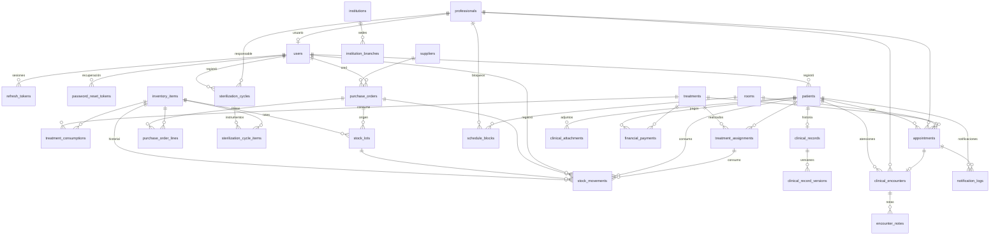

# Estructura base del backend — ClinicApp

Estado al **2026-11-17**: base del proyecto, `auth`, catálogo de `treatments` (con sus insumos), `inventory`, `patients`, `appointments` (profesionales, consultorios, citas y bloqueos), `clinical-history`, `institution`, `notifications`, `finance` (etapa A) y `reports`: **todos los módulos del frontend**. Este documento describe **cómo está armada la API y qué guarda la base de datos**. Los endpoints están en [`endpoints-api.md`](./endpoints-api.md), y lo pendiente por módulo en [`../backlog.md`](../backlog.md).

## 1. Tecnología

| Pieza | Elección |
|---|---|
| API | .NET 10 (LTS), ASP.NET Core Web API con controladores |
| Acceso a datos | Entity Framework Core 10 + Npgsql. Migraciones en `Data/Migrations`; `dotnet-ef` 10.0.15 como herramienta local (`dotnet tool restore`). |
| Base de datos | PostgreSQL 17 en Docker (`docker-compose.yml`, contenedor `clinicapp-db`, puerto local 5433) |
| Autenticación | JWT (`Microsoft.AspNetCore.Authentication.JwtBearer` 10.0.15) y cookie de refresh `httpOnly` |
| Documentación interactiva | OpenAPI en `/openapi/v1.json` y Scalar en `/scalar` (solo en desarrollo) |

Los paquetes NuGet se fijan en la versión **10.0.15**: las versiones 11.x apuntan a .NET 11 y no compilan en este proyecto.

## 2. Organización del código

Un solo proyecto (`src/ClinicApp.Api`), con una carpeta por módulo. Los nombres de los módulos son los mismos de `front/src/modules/`.

```text
back/
├── ClinicApp.slnx, global.json, dotnet-tools.json
├── docker-compose.yml, .env.example        ← base de datos local
├── README.md, backlog.md, backlog-desgloce.md
├── docs/                                    ← este documento, endpoints-api.md y los planes en curso
├── tutorial/fase-0.md                       ← guía paso a paso de cómo se armó la base
├── tests/ClinicApp.Api.Tests/              ← pruebas unitarias y de integración (ver docs/pruebas.md)
└── src/ClinicApp.Api/
    ├── Program.cs                           ← servicios y pipeline (orden de los middlewares)
    ├── appsettings.json, appsettings.Development.json
    ├── ClinicApp.Api.http                   ← peticiones de prueba
    ├── Common/
    │   ├── Paging.cs                        ← PageQuery, PagedResult<T>, ToPagedResultAsync
    │   ├── ProblemDetailsSetup.cs           ← títulos de error en español; 500 sin detalle en producción
    │   ├── Validation.cs                    ← título de los 400, ValidationError(), FieldConflict() (409 con campo), [IsoDate]
    │   ├── ClinicClock.cs                   ← "hoy" y conversión de horas en la zona horaria de la clínica
    │   ├── TextSearch.cs                    ← búsqueda sin tildes (unaccent) y patrones ILIKE
    │   ├── JsonbConversion.cs               ← HasJsonbConversion(): una clase de C# en una columna jsonb
    │   ├── RateLimits.cs                    ← límite de intentos de los endpoints públicos de auth
    │   ├── Email.cs                         ← IEmailSender (hoy solo escribe en el log)
    │   └── BearerSecuritySchemeTransformer.cs ← botón "Bearer" en Scalar
    ├── Data/
    │   ├── AppDbContext.cs                  ← un DbSet por tabla
    │   └── Migrations/
    └── Modules/
        ├── Auth/         ← usuarios, sesiones, recuperación de contraseña, solicitudes de acceso
        ├── Treatments/   ← catálogo de tratamientos, sus insumos y los tratamientos realizados
        ├── Inventory/    ← insumos, lotes, movimientos, proveedores, órdenes, esterilización
        ├── Patients/     ← pacientes (baja lógica, N.° de historia clínica)
        ├── Appointments/ ← profesionales, consultorios, citas y bloqueos de horario
        ├── ClinicalHistory/ ← historia, versiones, atenciones, notas y adjuntos
        ├── Institution/  ← perfil de la clínica y sus sedes
        ├── Notifications/ ← plantilla, registro y envío automático de avisos de citas
        ├── Finance/      ← pagos de los pacientes, cartera y resúmenes
        └── Reports/      ← los 5 reportes por periodo (consultas agrupadas)
```

**Patrón de cada módulo:**

| Archivo | Contenido |
|---|---|
| `*Entities.cs` o `<Entidad>.cs` | Clases que se convierten en tablas |
| `*Configuration.cs` | Detalles de cada tabla: largos, precisión, índices, `CHECK`, llaves foráneas. `AppDbContext` las aplica todas solo, con `ApplyConfigurationsFromAssembly`. |
| `*Dtos.cs` | Lo que entra y sale de la API. Son clases distintas de las entidades, para que la tabla pueda cambiar sin romper el contrato del frontend. Las reglas de validación replican los esquemas Zod del frontend. |
| `*Controller.cs` | Los endpoints |
| Servicios (`TokenService`, `StockService`) | Lógica compartida que no pertenece a un solo endpoint |

## 3. Convenciones de la base de datos

| Tema | Regla |
|---|---|
| Nombres | snake_case (`UseSnakeCaseNamingConvention`): `DurationMinutes` → `duration_minutes`, `pk_treatments`, `fk_stock_lots_inventory_items_item_id` |
| Identificadores | `uuid`. Los genera el servidor con `Guid.CreateVersion7()` (UUID v7: crecen con el tiempo, así que también sirven para ordenar). |
| Fechas con hora | `timestamptz`, siempre en UTC (`DateTime.UtcNow`) |
| Fechas sin hora | `date` (`DateOnly` en C#). En el JSON van como `"YYYY-MM-DD"`. |
| Dinero | `numeric(10,2)` (`decimal` en C#): hasta 99 999 999,99 sin errores de redondeo |
| Texto | `varchar(n)` con el largo máximo del formulario |
| Opciones fijas | Texto con restricción `CHECK` (por ejemplo `role IN ('admin', 'recepcion', 'medico')`). Los valores son los mismos del frontend. |
| Estructuras anidadas | `jsonb`: `users.profile` y las secciones de la historia clínica |
| Borrados | Las tablas de historia (movimientos, lotes) usan **restrict**: no se puede borrar lo que tiene historial. Las partes de un todo (líneas de una orden, consumos de un tratamiento, tokens de un usuario) usan **cascade**. Las referencias de auditoría a `users` usan **set null**. |
| Auditoría | `created_by_user_id` en movimientos de stock, órdenes de compra y ciclos de esterilización (no se expone en la API) |
| Secretos | En la base nunca hay contraseñas ni tokens en claro: contraseñas con PBKDF2 (`PasswordHasher`), tokens de sesión y de recuperación como hash SHA-256 |

## 4. Diagrama de tablas



`access_requests` no tiene relaciones. `treatment_assignments.source_encounter_id` es un UUID **sin llave foránea** todavía (ver § 14).

## 5. Módulo `auth`

### `users`

| Columna | Tipo | Nulo | Reglas |
|---|---|---|---|
| `id` | `uuid` PK | | |
| `email` | `varchar(254)` | | Único. Se guarda en minúsculas. |
| `name` | `varchar(120)` | | Nombre que se muestra |
| `password_hash` | `varchar(200)` | | PBKDF2. Se vuelve a calcular al iniciar sesión si el algoritmo se actualiza. |
| `role` | `varchar(20)` | | `admin`, `recepcion` o `medico` (`ck_users_role`) |
| `professional_id` | `uuid` FK → `professionals` (set null) | sí | Profesional vinculado. Único cuando no es `null`: un profesional tiene como máximo un usuario. |
| `active` | `boolean` | | Una cuenta desactivada no puede iniciar sesión (`403`) |
| `profile` | `jsonb` | sí | "Mi perfil": `{ fullName, title, specialty, bio, avatarColor, avatarImage }`. `avatarImage` es una data URL de hasta ~300 KB. |
| `created_at` | `timestamptz` | | |
| `last_login_at` | `timestamptz` | sí | |

### `refresh_tokens`

| Columna | Tipo | Nulo | Reglas |
|---|---|---|---|
| `id` | `uuid` PK | | |
| `user_id` | `uuid` FK → `users` (cascade) | | Índice |
| `token_hash` | `varchar(64)` | | SHA-256 en hexadecimal del token de la cookie. Único. |
| `created_at`, `expires_at` | `timestamptz` | | Vida: 7 días (`Auth:RefreshTokenDays`) |
| `revoked_at` | `timestamptz` | sí | Al cerrar sesión, al rotar o al detectar reuso |
| `replaced_by_token_id` | `uuid` | sí | Token que lo reemplazó al rotar. Sirve para detectar el reuso de un token robado. |

### `password_reset_tokens`

| Columna | Tipo | Nulo | Reglas |
|---|---|---|---|
| `id` | `uuid` PK | | |
| `user_id` | `uuid` FK → `users` (cascade) | | Índice |
| `token_hash` | `varchar(64)` | | SHA-256 del token del enlace. Único. |
| `created_at`, `expires_at` | `timestamptz` | | Vida: 60 minutos (`Auth:PasswordResetMinutes`) |
| `used_at` | `timestamptz` | sí | Un solo uso. Al pedir un enlace nuevo, los anteriores se invalidan. |

### `access_requests`

| Columna | Tipo | Nulo | Reglas |
|---|---|---|---|
| `id` | `uuid` PK | | |
| `email` | `varchar(254)` | | |
| `full_name` | `varchar(120)` | | |
| `institution` | `varchar(160)` | | Vacío si no se indicó |
| `message` | `varchar(1000)` | | Vacío si no se indicó |
| `status` | `varchar(20)` | | Siempre `pendiente` por ahora (no hay pantalla para revisarlas) |
| `created_at` | `timestamptz` | | Índice |

**Cuentas de desarrollo** (`UserSeeder`): con la tabla `users` vacía y en `Development`, se crean `admin@clinica.com` / `admin123`, `recepcion@clinica.com` / `recepcion123` y `medico@clinica.com` / `medico123`. En cualquier entorno se crea un administrador inicial si existen `Seed__AdminEmail` y `Seed__AdminPassword` (mínimo 12 caracteres).

## 6. Módulo `treatments`

### `treatments`

| Columna | Tipo | Nulo | Reglas |
|---|---|---|---|
| `id` | `uuid` PK | | |
| `name` | `varchar(120)` | | 2 a 120 caracteres |
| `category` | `varchar(80)` | | 2 a 80 caracteres |
| `description` | `varchar(1000)` | sí | |
| `duration_minutes` | `integer` | | 5 a 1440 |
| `price` | `numeric(10,2)` | | Precio de catálogo, 0 a 99 999 999,99 |
| `active` | `boolean` | | Los inactivos no se ofrecen en la historia clínica |
| `created_at` | `timestamptz` | | |

### `treatment_consumptions`

Insumos que consume un tratamiento cada vez que se realiza.

| Columna | Tipo | Nulo | Reglas |
|---|---|---|---|
| `treatment_id` | `uuid` FK → `treatments` (cascade) | | PK compuesta `(treatment_id, item_id)`: un insumo no se repite en el mismo tratamiento |
| `item_id` | `uuid` FK → `inventory_items` (restrict) | | Índice |
| `quantity` | `integer` | | ≥ 1 (`CHECK`) |

### `treatment_assignments`

Tratamientos realizados a un paciente. La API los registra ya completados desde la historia clínica.

| Columna | Tipo | Nulo | Reglas |
|---|---|---|---|
| `id` | `uuid` PK | | |
| `treatment_id` | `uuid` FK → `treatments` (restrict) | | Índice `(treatment_id, start_date)` |
| `patient_id` | `uuid` FK → `patients` (restrict) | | Índice `(patient_id, start_date)` |
| `total_sessions`, `completed_sessions` | `integer` | | 1 y 1 al registrar. `CHECK (0 ≤ completed ≤ total, total ≥ 1)`. |
| `status` | `varchar(15)` | | `en_progreso`, `completado`, `suspendido` (`CHECK`) |
| `start_date` | `date` | | Fecha de la atención; no futura |
| `tooth` | `varchar(60)` | | Pieza o zona; `""` si no aplica |
| `source_encounter_id` | `uuid` | sí | Atención de origen. **Sin FK** por ahora: el frontend registra el tratamiento antes de crear la atención. |
| `source_key` | `varchar(200)` | sí | Idempotencia (atención + ítem). Único cuando no es `null`. |
| `price` | `numeric(10,2)` | sí | Costo cobrado (`CHECK ≥ 0`). `null` en asignaciones antiguas: vale el precio del catálogo. |
| `professional_id` | `uuid` FK → `professionals` (restrict) | sí | Profesional que lo realizó: lo llena `POST …/encounters/register` (el registro por pasos lo deja vacío) |
| `created_at` | `timestamptz` | | |
| `created_by_user_id` | `uuid` FK → `users` (set null) | sí | |

## 7. Módulo `inventory`

**Regla central:** `inventory_items.stock` es siempre igual a la suma de `stock_lots.quantity` del insumo.
- **Quién lo cambia:** solo `StockService`. Bloquea la fila del insumo (`SELECT … FOR UPDATE`) dentro de una transacción, así dos salidas simultáneas no pueden dejar el stock negativo.
- **Entradas:** cada entrada crea un lote.
- **Salidas:** descuentan por FEFO (primero en vencer, primero en salir). Los lotes sin vencimiento salen al final y, entre lotes iguales, sale primero el más antiguo. Se crea un movimiento por cada lote tocado.

### `inventory_items`

| Columna | Tipo | Nulo | Reglas |
|---|---|---|---|
| `id` | `uuid` PK | | |
| `name` | `varchar(120)` | | 2 a 120. Índice. |
| `category` | `varchar(80)` | | 2 a 80 |
| `unit` | `varchar(30)` | | "caja", "unidad", "ml"... |
| `kind` | `varchar(20)` | | `consumible` o `instrumental` (`CHECK`) |
| `min_stock` | `integer` | | ≥ 0. Si `stock <= min_stock`, el insumo está en stock crítico. |
| `unit_cost` | `numeric(10,2)` | | ≥ 0 |
| `supplier` | `varchar(120)` | sí | Texto libre (no enlaza con `suppliers`) |
| `stock` | `integer` | | ≥ 0 (`CHECK`). Solo lo cambia el servidor. |
| `created_at` | `timestamptz` | | |

### `stock_lots`

| Columna | Tipo | Nulo | Reglas |
|---|---|---|---|
| `id` | `uuid` PK | | |
| `item_id` | `uuid` FK → `inventory_items` (restrict) | | Índice `(item_id, expiration_date)` para el orden FEFO |
| `quantity` | `integer` | | Cantidad **restante**, ≥ 0 |
| `expiration_date` | `date` | sí | |
| `purchase_order_id` | `uuid` FK → `purchase_orders` (restrict) | sí | Orden de origen |
| `received_at` | `timestamptz` | | |

### `stock_movements` (inmutable)

| Columna | Tipo | Nulo | Reglas |
|---|---|---|---|
| `id` | `uuid` PK | | |
| `item_id` | `uuid` FK → `inventory_items` (restrict) | | Índice `(item_id, created_at)` |
| `type` | `varchar(10)` | | `entrada` o `salida` (`CHECK`) |
| `quantity` | `integer` | | > 0 |
| `reason` | `varchar(300)` | | |
| `lot_id` | `uuid` FK → `stock_lots` (restrict) | sí | Lote creado (entrada) o descontado (salida) |
| `purchase_order_id` | `uuid` FK → `purchase_orders` (restrict) | sí | |
| `treatment_assignment_id` | `uuid` FK → `treatment_assignments` (restrict) | sí | Tratamiento realizado que consumió el insumo |
| `patient_id` | `uuid` FK → `patients` (restrict) | sí | |
| `created_by_user_id` | `uuid` FK → `users` (set null) | sí | Auditoría |
| `created_at` | `timestamptz` | | |

### `suppliers`

| Columna | Tipo | Nulo | Reglas |
|---|---|---|---|
| `id` | `uuid` PK | | |
| `name` | `varchar(120)` | | 2 a 120 |
| `contact_name` | `varchar(120)` | sí | |
| `phone` | `varchar(30)` | sí | |
| `email` | `varchar(254)` | sí | Correo válido, en minúsculas |
| `address` | `varchar(250)` | sí | |
| `notes` | `varchar(1000)` | sí | |
| `created_at` | `timestamptz` | | |

### `purchase_orders`

| Columna | Tipo | Nulo | Reglas |
|---|---|---|---|
| `id` | `uuid` PK | | |
| `supplier_id` | `uuid` FK → `suppliers` (restrict) | | Índice |
| `status` | `varchar(20)` | | `pendiente`, `recibida` o `cancelada` (`CHECK`) |
| `notes` | `varchar(1000)` | sí | |
| `created_by_user_id` | `uuid` FK → `users` (set null) | sí | |
| `created_at` | `timestamptz` | | Índice |
| `received_at` | `timestamptz` | sí | Se fija al recibir |

### `purchase_order_lines`

| Columna | Tipo | Nulo | Reglas |
|---|---|---|---|
| `id` | `uuid` PK | | No se expone |
| `purchase_order_id` | `uuid` FK → `purchase_orders` (cascade) | | |
| `position` | `integer` | | Orden de la línea en la orden (0, 1, 2...) |
| `item_id` | `uuid` FK → `inventory_items` (restrict) | | |
| `quantity` | `integer` | | ≥ 1 |
| `unit_cost` | `numeric(10,2)` | | ≥ 0 |
| `expiration_date` | `date` | sí | Vencimiento del lote que se crea al recibir |

### `sterilization_cycles`

| Columna | Tipo | Nulo | Reglas |
|---|---|---|---|
| `id` | `uuid` PK | | |
| `performed_at` | `date` | | No futura. Índice. |
| `result` | `varchar(20)` | | `aprobado` o `fallido` (`CHECK`) |
| `responsible_professional_id` | `uuid` FK → `professionals` (restrict) | | Profesional existente y activo (lo valida la API) |
| `notes` | `varchar(1000)` | sí | |
| `created_by_user_id` | `uuid` FK → `users` (set null) | sí | |
| `created_at` | `timestamptz` | | |

### `sterilization_cycle_items`

| Columna | Tipo | Nulo | Reglas |
|---|---|---|---|
| `cycle_id` | `uuid` FK → `sterilization_cycles` (cascade) | | PK compuesta `(cycle_id, item_id)` |
| `item_id` | `uuid` FK → `inventory_items` (restrict) | | Solo insumos `instrumental` (lo valida la API) |

## 8. Módulo `patients`

### `patients`

Baja lógica: un paciente nunca se borra, porque tiene citas, tratamientos, historia y pagos. Los textos opcionales se guardan como `""`.

| Columna | Tipo | Nulo | Reglas |
|---|---|---|---|
| `id` | `uuid` PK | | |
| `record_number` | `integer` | | N.° de historia clínica. Lo asigna la secuencia `patient_record_number_seq` (`DEFAULT nextval(...)`). Único. La API lo muestra como `HC-000123`. |
| `first_name`, `last_name` | `varchar(80)` | | 2 a 80 |
| `document_id` | `varchar(20)` | | Cédula o pasaporte. Índice **no único**: los datos que se importarán tienen cédulas repetidas. La API rechaza repetidas entre pacientes activos. |
| `document_type` | `varchar(10)` | | `cedula`, `pasaporte`, `otro` o `''` sin indicar (`CHECK`). Con `cedula` la API valida el dígito verificador. |
| `birth_date` | `date` | sí | Obligatoria en la API; nulable solo para datos importados con fechas imposibles |
| `gender` | `varchar(10)` | | `femenino`, `masculino`, `otro` (`CHECK`) |
| `marital_status` | `varchar(15)` | | `""` o 5 opciones (`CHECK`) |
| `occupation`, `company` | `varchar(120)` | | |
| `nationality` | `varchar(60)` | | |
| `phone` | `varchar(30)` | | Opcional (`''`); si hay, al menos 7 dígitos |
| `email` | `varchar(254)` | | En minúsculas, o `""` |
| `address` | `varchar(250)` | | |
| `city` | `varchar(120)` | | |
| `notes` | `varchar(2000)` | | |
| `notifications_enabled` | `boolean` | | `true` por defecto |
| `emergency_contact_name` / `_relationship` / `_phone` | `varchar(120)` / `(60)` / `(30)` | | |
| `insurance_provider`, `insurance_policy` | `varchar(120)`, `varchar(60)` | | |
| `consent_signed` | `boolean` | | |
| `treatment_status` | `varchar(20)` | | `activo`, `en seguimiento`, `pendiente`, `inactivo` (`CHECK`) |
| `last_visit_at` | `date` | sí | Manual por ahora |
| `created_at` | `timestamptz` | | Índice (orden de la lista) |
| `updated_at` | `timestamptz` | sí | |
| `created_by_user_id`, `updated_by_user_id` | `uuid` FK → `users` (set null) | sí | Auditoría |
| `deleted_at` | `timestamptz` | sí | Baja lógica. Índice. |
| `deleted_by_user_id` | `uuid` FK → `users` (set null) | sí | |

**Búsqueda sin tildes:** la extensión `unaccent` de PostgreSQL (`TextSearch.Unaccent` en el código) permite que "perez" encuentre "Pérez".

## 9. Módulo `appointments`

Agenda: catálogos (que no se borran, se desactivan con `active = false`), citas y bloqueos de horario.

### `professionals`

| Columna | Tipo | Nulo | Reglas |
|---|---|---|---|
| `id` | `uuid` PK | | |
| `name` | `varchar(120)` | | 3 a 120, con el título ("Dra. Carla Ríos"). Índice. |
| `specialty` | `varchar(80)` | | 2 a 80 |
| `registration_number` | `varchar(40)` | | Registro MSP / Senescyt; `""` si no se registró |
| `active` | `boolean` | | |
| `created_at` | `timestamptz` | | |

El usuario vinculado está en `users.professional_id` (único).

### `rooms`

| Columna | Tipo | Nulo | Reglas |
|---|---|---|---|
| `id` | `uuid` PK | | |
| `name` | `varchar(60)` | | 2 a 60. Índice único entre los activos (`WHERE active`). |
| `active` | `boolean` | | |
| `created_at` | `timestamptz` | | |

### `appointments`

Las horas van en UTC; la API convierte desde y hacia la hora de la clínica.

| Columna | Tipo | Nulo | Reglas |
|---|---|---|---|
| `id` | `uuid` PK | | |
| `patient_id` | `uuid` FK → `patients` (restrict) | | Índice `(patient_id, start)` |
| `professional_id` | `uuid` FK → `professionals` (restrict) | | Índice `(professional_id, start)` |
| `treatment_id` | `uuid` FK → `treatments` (restrict) | sí | |
| `room_id` | `uuid` FK → `rooms` (restrict) | sí | Índice `(room_id, start)` |
| `start`, `end` | `timestamptz` | | `CHECK (end > start)`. Índice `start`. |
| `status` | `varchar(15)` | | `programada`, `confirmada`, `cancelada`, `completada`, `no_asistio` (`CHECK`) |
| `notes` | `varchar(1000)` | sí | |
| `created_at`, `updated_at` | `timestamptz` | `updated_at` sí | |
| `created_by_user_id` | `uuid` FK → `users` (set null) | sí | |
| `status_changed_at` | `timestamptz` | sí | Último cambio de estado |
| `status_changed_by_user_id` | `uuid` FK → `users` (set null) | sí | |

### `schedule_blocks`

| Columna | Tipo | Nulo | Reglas |
|---|---|---|---|
| `id` | `uuid` PK | | |
| `professional_id` | `uuid` FK → `professionals` (restrict) | sí | |
| `room_id` | `uuid` FK → `rooms` (restrict) | sí | `CHECK`: al menos uno de los dos |
| `start`, `end` | `timestamptz` | | `CHECK (end > start)`. Índice `start`. |
| `reason` | `varchar(300)` | | |
| `created_at` | `timestamptz` | | |
| `created_by_user_id` | `uuid` FK → `users` (set null) | sí | |

**Sin choques de horario:** lo garantiza la API (`AvailabilityService`), no la base, porque el choque puede ser con otra tabla (un bloqueo). Para que dos peticiones simultáneas no pasen las dos, toma un candado de PostgreSQL (`pg_advisory_xact_lock`) por profesional y por consultorio durante la transacción.

## 10. Módulo `clinical-history`

Las secciones anidadas del formulario van en columnas `jsonb` (una por sección), guardadas con `HasJsonbConversion()` (`Common/JsonbConversion.cs`) y validadas por la API con las reglas de los esquemas Zod. Lo que se busca, filtra u ordena va en columnas normales.

### `clinical_records` (una por paciente)

| Columna | Tipo | Nulo | Reglas |
|---|---|---|---|
| `patient_id` | `uuid` PK, FK → `patients` (restrict) | | |
| `revision` | `integer` | | Concurrencia optimista (token de EF Core) |
| `chart` | `jsonb` | sí | Odontograma y periodontograma tal como los exporta la librería; no se valida por dentro |
| `medical_background`, `allergies_and_medication`, `habits`, `dental_background`, `periodontal_background`, `plan`, `data_consent`, `truth_declaration`, `exam_requests` | `jsonb` | | Una sección cada una |
| `created_at`, `updated_at` | `timestamptz` | | |
| `updated_by_user_id` | `uuid` FK → `users` (set null) | sí | |

### `clinical_record_versions` (inmutable)

| Columna | Tipo | Nulo | Reglas |
|---|---|---|---|
| `id` | `uuid` PK | | |
| `patient_id` | `uuid` FK → `clinical_records` (restrict) | | Único `(patient_id, revision)` |
| `revision` | `integer` | | La revisión que se reemplazó |
| `data` | `jsonb` | sí | La historia completa en esa revisión (con la forma de la respuesta de la API) |
| `saved_by_user_id` | `uuid` FK → `users` (set null) | sí | Quién había guardado esa versión |
| `saved_at` | `timestamptz` | | Cuándo |

### `clinical_encounters` (inmutable)

| Columna | Tipo | Nulo | Reglas |
|---|---|---|---|
| `id` | `uuid` PK | | Lo genera el frontend (idempotencia) |
| `patient_id` | `uuid` FK → `patients` (restrict) | | Índice `(patient_id, date)` |
| `date` | `date` | | No futura. Índice. |
| `professional_id` | `uuid` FK → `professionals` (restrict) | | Índice |
| `legacy_professional_name` | `varchar(120)` | sí | Solo para atenciones importadas |
| `appointment_id` | `uuid` FK → `appointments` (restrict) | sí | Único cuando no es `null`: una cita, una atención |
| `reason`, `present_illness` | `varchar(500)`, `varchar(2000)` | | |
| `asa` | `varchar(3)` | | `''`, `I` a `IV` (`CHECK`) |
| `vitals`, `risk_assessment`, `extraoral_exam`, `intraoral_exam`, `pain`, `caries_risk`, `periodontal_risk`, `diagnoses`, `prognosis`, `periodontal_diagnosis`, `maintenance_interval`, `requested_exams`, `performed_treatments` | `jsonb` | | Una sección cada una |
| `chart_snapshot`, `clinical_snapshot` | `jsonb` | sí | Copias del odontograma y de las alertas al guardar |
| `diagnosis_summary` | `text` | | Diagnósticos unidos por " · ", para buscar. No se expone. |
| `procedures`, `evolution`, `notes` | `varchar(4000)` | | |
| `materials`, `exam_findings` | `varchar(1000)` | | |
| `next_visit` | `date` | sí | |
| `created_by_user_id` | `uuid` FK → `users` (set null) | sí | |
| `created_at` | `timestamptz` | | |

### `encounter_notes` (inmutable)

| Columna | Tipo | Nulo | Reglas |
|---|---|---|---|
| `id` | `uuid` PK | | |
| `encounter_id` | `uuid` FK → `clinical_encounters` (restrict) | | |
| `text` | `varchar(4000)` | | Mínimo 10 |
| `author_user_id` | `uuid` FK → `users` (set null) | sí | |
| `author_name` | `varchar(120)` | | Copia del nombre al firmar |
| `created_at` | `timestamptz` | | |

### `clinical_attachments`

| Columna | Tipo | Nulo | Reglas |
|---|---|---|---|
| `id` | `uuid` PK | | |
| `patient_id` | `uuid` FK → `patients` (restrict) | | Índice |
| `alias` | `varchar(255)` | | Nombre con que lo subió el usuario (`name` en la API) |
| `kind` | `varchar(30)` | | 12 tipos (`CHECK`) |
| `mime` | `varchar(50)` | | JPG, PNG, WebP o PDF (`CHECK`); lo decide el servidor por los primeros bytes |
| `size` | `bigint` | | 1 byte a 20 MB (`CHECK`) |
| `storage_path` | `varchar(200)` | | `{patientId}/{id}.{ext}`, relativo a `Attachments:RootPath`. No se expone. |
| `linked_at` | `timestamptz` | sí | `null` = nunca se guardó en una historia (se borra a las 24 h) |
| `removed_at` | `timestamptz` | sí | Se quitó de la historia; el archivo se conserva |
| `purged_at` | `timestamptz` | sí | El protocolo de conservación borró el archivo (apagado por defecto); la fila queda |
| `uploaded_by_user_id` | `uuid` FK → `users` (set null) | sí | |
| `created_at` | `timestamptz` | | Índice `(linked_at, created_at)` para la limpieza |
| `digest` | `varchar(64)` | sí | SHA-256 (hex) del archivo, calculado por el servidor. Índice `(patient_id, digest)`: detecta originales repetidos. |
| `metadata_version` | `integer` | | 0 = sin metadatos del archivo clínico; sube con cada edición o archivado (concurrencia optimista) |
| `display_name`, `clinical_type` | `varchar(200)`, `varchar(40)` | | Nombre visible y tipo clínico (los de `ArchiveKeys.ClinicalTypes`); `''` sin metadatos |
| `study_date` | `date` | sí | Fecha del estudio |
| `category_id` | `uuid` FK → `archive_categories` (set null) | sí | |
| `professional_id` | `uuid` FK → `professionals` (set null) | sí | |
| `encounter_id` | `uuid` FK → `clinical_encounters` (set null) | sí | Debe ser una atención del paciente |
| `treatment_assignment_id` | `uuid` FK → `treatment_assignments` (set null) | sí | Tratamiento realizado del paciente (`treatmentId` en la API) |
| `exam_request_id` | `varchar(60)` | sí | Examen solicitado de la historia cuyo resultado es este archivo; no se reasigna |
| `zone`, `notes` | `varchar(150)`, `varchar(3000)` | | |
| `metadata_updated_at`, `archived_at` | `timestamptz` | sí | `archived_at`: archivado (sigue en la historia; la vista lo oculta) |

**Archivos:** en `Attachments:RootPath` (producción: `/var/lib/clinicapp/attachments`, incluida en los respaldos; desarrollo: `App_Data/attachments`, ignorada por git). La tarea `AttachmentCleanupService` corre cada hora.

### `archive_categories` y `archive_tags` (catálogo del archivo clínico)

| Tabla | Columnas |
|---|---|
| `archive_categories` | `id uuid` PK, `name varchar(60)`, `description varchar(300)`, `color varchar(20)` (`neutral`, `cyan`, `violet`, `amber`, `green`; `CHECK`), `archived_at`, `version integer`, `created_at`, `updated_at` |
| `archive_tags` | `id uuid` PK, `name varchar(40)`, `version integer`, `created_at`, `updated_at` |

Los nombres no se repiten sin tildes ni mayúsculas: lo controla la API, con un candado de PostgreSQL (`archive-catalog`). Nada se borra; las categorías se archivan.

### `clinical_attachment_tags`

`(attachment_id, tag_id)` PK; `attachment_id` FK → `clinical_attachments` (cascade), `tag_id` FK → `archive_tags` (cascade), `position integer` (orden en que se eligieron).

### `clinical_attachment_audit`

| Columna | Tipo | Nulo | Reglas |
|---|---|---|---|
| `id` | `uuid` PK | | |
| `attachment_id` | `uuid` FK → `clinical_attachments` (cascade) | | Índice `(attachment_id, at)` |
| `action` | `varchar(20)` | | `adjuntar`, `editar`, `archivar`, `restaurar` (`CHECK`) |
| `fields` | `text[]` | | Campos que cambiaron (nombres del JSON) |
| `actor_user_id` | `uuid` FK → `users` (set null) | sí | |
| `actor_name` | `varchar(120)` | | Nombre del usuario en ese momento |
| `at` | `timestamptz` | | |

## 11. Módulo `institution`

### `institutions` (una sola fila por ahora)

Si se aprueba la multi-clínica (`plan-multiclinica.md`, M1), esta misma tabla tendrá una fila por clínica.

| Columna | Tipo | Nulo | Reglas |
|---|---|---|---|
| `id` | `uuid` PK | | Fijo (`00000000-0000-7000-8000-0000000000c1`) |
| `name` | `varchar(160)` | | Nombre comercial |
| `subtitle` | `varchar(120)` | | Texto debajo del nombre (login y barra lateral); `''` si no hay |
| `legal_name` | `varchar(200)` | | Razón social |
| `ruc` | `varchar(13)` | | 13 dígitos o `''` (`CHECK`) |
| `phone`, `email`, `address`, `website` | `varchar(30)`, `(254)`, `(250)`, `(200)` | | |
| `logo_text` | `varchar(10)` | | Iniciales que se muestran sin imagen |
| `logo_image` | `text` | sí | Data URL PNG, JPG o WebP de hasta ~500 KB |
| `notes`, `hours` | `varchar(1000)`, `varchar(500)` | | |
| `updated_at` | `timestamptz` | | |
| `updated_by_user_id` | `uuid` FK → `users` (set null) | sí | |

### `institution_branches`

| Columna | Tipo | Nulo | Reglas |
|---|---|---|---|
| `id` | `uuid` PK | | UUID v7 que genera el servidor |
| `institution_id` | `uuid` FK → `institutions` (cascade) | | |
| `position` | `integer` | | Orden en la pantalla. La API muestra "Sede N" (N = lugar en la lista) si `name` está vacío. |
| `name`, `address`, `phone`, `hours` | `varchar(120)`, `(250)`, `(30)`, `(500)` | | |
| `is_main` | `boolean` | | Índice único parcial `WHERE is_main`: como máximo una principal |

## 12. Módulo `notifications`

### `notification_templates` (una fila)

| Columna | Tipo | Nulo | Reglas |
|---|---|---|---|
| `id` | `uuid` PK | | Fijo. La migración inserta la plantilla predeterminada del mock. |
| `message` | `varchar(1000)` | | 10 a 1000, con variables como `[nombre del cliente]` |
| `updated_at` | `timestamptz` | | |
| `updated_by_user_id` | `uuid` FK → `users` (set null) | sí | |

### `notification_logs`

| Columna | Tipo | Nulo | Reglas |
|---|---|---|---|
| `id` | `uuid` PK | | |
| `patient_id` | `uuid` FK → `patients` (restrict) | | |
| `appointment_id` | `uuid` FK → `appointments` (restrict) | sí | Único `(appointment_id, type)`: el mismo aviso no se repite para una cita |
| `type` | `varchar(25)` | | `recordatorio_cita`, `confirmacion_cita`, `cancelacion_cita` (`CHECK`) |
| `channel` | `varchar(10)` | | `email`, `sms`, `whatsapp` (`CHECK`) |
| `status` | `varchar(10)` | | `pendiente` (interno), `enviada`, `fallida` (`CHECK`). Índice `(status, created_at)`. |
| `recipient` | `varchar(254)` | | Teléfono o correo usado. No se expone. |
| `message` | `varchar(1200)` | | Mensaje ya armado. No se expone. |
| `error` | `varchar(500)` | sí | Motivo de la última falla |
| `attempts` | `integer` | | Al tercer intento fallido, `fallida` |
| `created_at` | `timestamptz` | | |
| `sent_at` | `timestamptz` | sí | Índice (orden y filtro del reporte) |

**Envío:** la notificación se guarda `pendiente` junto con la cita (patrón *outbox*) y la envía la tarea `NotificationDispatcher` a través de `INotificationSender`. El proveedor real todavía no está elegido.

## 13. Módulo `finance`

### `financial_payments`

Pagos de los pacientes por sus tratamientos. Un pago no se borra: se anula, con motivo.

| Columna | Tipo | Nulo | Reglas |
|---|---|---|---|
| `id` | `uuid` PK | | |
| `patient_id` | `uuid` FK → `patients` (restrict) | | Índice `(patient_id, treatment_id)` |
| `treatment_id` | `uuid` FK → `treatments` (restrict) | | El paciente debe tener ese tratamiento realizado (lo valida la API) |
| `date` | `date` | | No futura. Índice. |
| `amount` | `numeric(10,2)` | | `CHECK (amount > 0)`; no puede superar el saldo pendiente (lo valida la API) |
| `method` | `varchar(20)` | | 7 métodos (`CHECK`) |
| `reference`, `observations` | `varchar(100)`, `varchar(500)` | | |
| `status` | `varchar(10)` | | `registrado`, `anulado`, `reversado` (`CHECK`) |
| `void_reason` | `varchar(300)` | sí | Obligatorio al anular |
| `registered_by_user_id`, `voided_by_user_id` | `uuid` FK → `users` (set null) | sí | |
| `created_at`, `voided_at` | `timestamptz` | `voided_at` sí | |

**La cartera no tiene tabla propia:** se calcula al leer, agrupando `treatment_assignments.price` y `financial_payments.amount` por paciente + tratamiento (`FinanceCalculator`). Cuotas, seguros y factura electrónica (etapa B) tendrán sus tablas cuando se diseñe el ítem 8.

## 14. Migraciones aplicadas

| Migración | Crea |
|---|---|
| `20261114042117_CrearTratamientos` | `treatments` |
| `20261115051345_CrearUsuariosYSesiones` | `users`, `refresh_tokens`, `password_reset_tokens`, `access_requests` |
| `20261115180228_CrearInventario` | Las 8 tablas de inventario y `treatment_consumptions` |
| `20261118023006_CrearPacientes` | `patients`, la secuencia `patient_record_number_seq`, la extensión `unaccent` y la FK `stock_movements.patient_id` → `patients` |
| `20261118023839_CrearProfesionalesYConsultorios` | `professionals`, `rooms` y las FK `users.professional_id` y `sterilization_cycles.responsible_professional_id`. Pasa los ciclos con responsables inexistentes a un profesional inactivo "Responsable no registrado". |
| `20261118024431_CrearCitas` | `appointments` y `schedule_blocks` |
| `20261118024917_CrearTratamientosRealizados` | `treatment_assignments` y la FK `stock_movements.treatment_assignment_id` |
| `20261118025957_CrearHistoriaClinica` | Las 5 tablas de la historia clínica (26 columnas `jsonb`) |
| `20261118030811_CrearInstitucion` | `institutions` e `institution_branches` |
| `20261118031243_CrearNotificaciones` | `notification_templates` (con la plantilla predeterminada) y `notification_logs` |
| `20261118031703_CrearPagos` | `financial_payments` |
| `20261118032137_IndicesReportes` | Índice `stock_movements (type, created_at)` para el reporte de inventario |
| `20261120175534_SedesConUuid` | `institution_branches.id` pasa de texto a `uuid` y queda como PK. Las sedes con ids de texto reciben un UUID nuevo. |
| `20261120191521_InstitucionSubtitulo` | Columna `institutions.subtitle` |
| `20261120191802_PacientesTipoDocumento` | Columna `patients.document_type` con su `CHECK` |
| `20261120193107_ArchivoClinico` | Archivo clínico: metadatos y huella en `clinical_attachments`, `archive_categories`, `archive_tags`, `clinical_attachment_tags` y `clinical_attachment_audit` |

Para crear o actualizar la base local: `dotnet ef database update --project src/ClinicApp.Api` (desde `back/`). Antes de aplicar una migración nueva, se revisa su SQL con `dotnet ef migrations script <anterior> <nueva> --project src/ClinicApp.Api`.

**Llaves foráneas pendientes:** se agregarán con una migración cuando existan las tablas destino.

| Columna | Tabla destino | Módulo |
|---|---|---|
| `treatment_assignments.source_encounter_id` | `clinical_encounters` | `clinical-history` |

**Módulos sin tablas propias:**
- `reports`: calcula sobre las demás tablas (con `ReportQueries`), sin tablas propias. Lo pendiente de cada módulo está en [`backlog.md`](../backlog.md).

**Multi-clínica (propuesta en espera):** el sistema se venderá a varias clínicas. Cuando se apruebe, se agrega la tabla `institutions` y la columna `institution_id` en las tablas de datos, con un filtro automático para que cada clínica vea solo lo suyo. Detalle en [`plan-multiclinica.md`](./plan-multiclinica.md). Mientras tanto, los módulos se hacen para una sola clínica.

## 15. Configuración

`appsettings.json` solo tiene valores no secretos. Los secretos y lo propio de cada entorno van en variables de entorno, con `__` en lugar de `:` (`Auth:SigningKey` → `Auth__SigningKey`). Si `ASPNETCORE_ENVIRONMENT` no está definida, .NET asume `Production`.

| Clave | Dónde | Valor |
|---|---|---|
| `ConnectionStrings:Default` | Desarrollo: `appsettings.Development.json`. Producción: variable de entorno. | Cadena de conexión de PostgreSQL |
| `Auth:Issuer`, `Auth:Audience` | `appsettings.json` | `clinicapp` |
| `Auth:AccessTokenMinutes`, `Auth:RefreshTokenDays`, `Auth:PasswordResetMinutes` | `appsettings.json` | 15, 7, 60 |
| `Auth:SigningKey` | Desarrollo: `appsettings.Development.json`. Producción: variable de entorno. | Al menos 32 caracteres. La API no arranca sin ella. |
| `Auth:FrontendBaseUrl` | Igual que la anterior | URL del frontend, para armar el enlace de recuperación de contraseña |
| `Cors:AllowedOrigins` | `appsettings*.json` | Orígenes del frontend (con cookies: `AllowCredentials`) |
| `Seed:AdminEmail`, `Seed:AdminPassword`, `Seed:AdminName` | Variable de entorno, solo la primera vez | Administrador inicial |
| `Seed:InstitutionName` | Variable de entorno, solo la primera vez | Nombre inicial del perfil de la institución |
| `ASPNETCORE_URLS`, `AllowedHosts` | Variable de entorno en producción | `http://127.0.0.1:5000`, el dominio |
| `Clinic:TimeZone` | `appsettings.json`; en producción, variable `Clinic__TimeZone` | Zona horaria IANA de la clínica (`America/Guayaquil`). Define "hoy" para las fechas que no pueden ser futuras. Un nombre inválido detiene el arranque. |
| `Attachments:RootPath` | `appsettings.json` (vacío = `App_Data/attachments`); en producción, `Attachments__RootPath=/var/lib/clinicapp/attachments` | Carpeta de los adjuntos. **Debe estar en los respaldos.** |
| `Attachments:OrphanHours`, `Attachments:CleanupIntervalMinutes` | `appsettings.json` | 24 y 60: los adjuntos nunca guardados se borran a las 24 h; la tarea corre cada hora |
| `Attachments:Retention:RemovedDays`, `Attachments:Retention:DryRun` | `appsettings.json` | Vacío y `true`: el protocolo de conservación está apagado. Ver `backlog.md` § `clinical-history`. |
| `Notifications:Provider` | Desarrollo: `log`. Producción: vacío hasta elegir proveedor (`Notifications__Provider`). | `log` escribe el mensaje en el log; vacío no registra notificaciones. Un valor desconocido detiene el arranque. |
| `Notifications:ReminderHoursBefore`, `Notifications:DispatchIntervalSeconds` | `appsettings.json` | 24 y 10 |

Los logs de consola incluyen el `TraceId` de cada petición (formato `simple` con scopes), el mismo que devuelven las respuestas de error.
